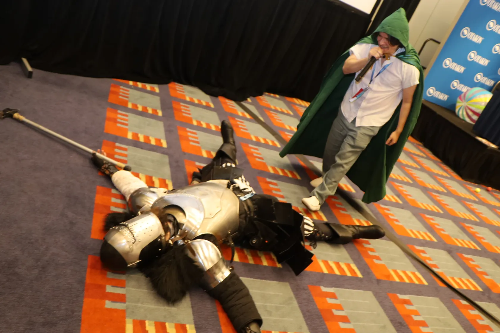
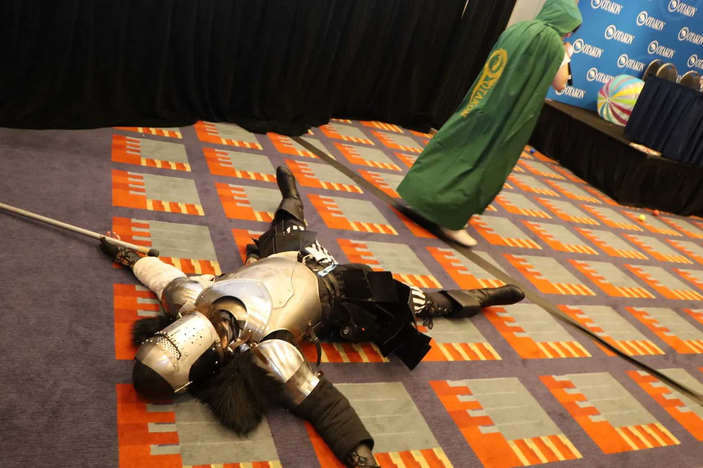

# Out of the Void

*Out of the Void* is an interactive show created and presented by Roberto Jose Beltran (AKA The Evil Schemer). It was produced by [Nerds Know](https://www.instagram.com/nerdsknow/) and premiered at [Otakon](https://otakon.com/) 2026 (Year of Swords and Sorcery). It is a decontruction of Dungeons & Dragons and the fan convention panel format where the entire crowd of participants assume the role of a single fantasy hero. It was inspired by Twitch Plays *Pokémon* and features themes of condemnation, death, and revival. *Out of the Void* serves as a foil to the adventure *Into the Void* of *The Wyrm and the Waveform* anthology, another Evil Schemer original. 

This repository holds the digital component of the show which also included physical and imaginative displays. It can viewed live on [Wicked Deeds](https://ootv.wickeddeeds.lol/).




## Developing

Once you've installed dependencies with `npm install`, start a development server:

```sh
npm run dev

```

## Building

To create a production version:

```sh
npm run build
```

You can preview the production build with `npm run preview`.

## Deploying

To deploy the production build to Cloudflare:

```sh
npm run deploy
```
